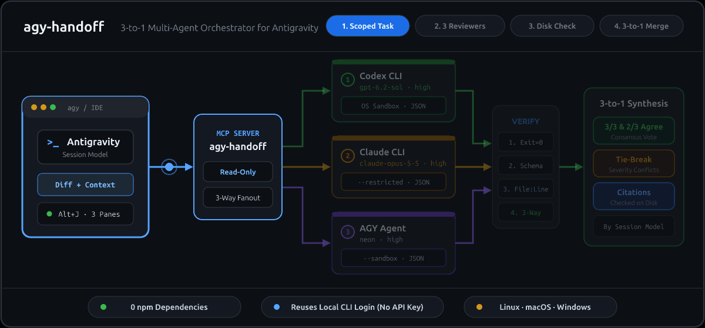

# agy-handoff

**agy-handoff**는 Google Antigravity (`agy` CLI, Antigravity IDE, Antigravity 2.0)에서 로컬 **OpenAI Codex CLI**, **Anthropic Claude Code CLI**, 그리고 **Google Antigravity Agent (기본값: `gemini-4-neon-high` / `neon high`)** 3개 모델을 병렬로 실행하고 **현재 세션의 대화 모델이 최종 취합(3-to-1)**하는 Zero-dependency stdio MCP 오케스트레이션 플러그인입니다.

별도 API 키 설정이나 `npm install` 없이 로컬에 로그인된 `codex` · `claude` · `agy` 인증을 그대로 재사용하며, 기존 2개 모델 비교 시 발생하던 1:1 의견 대립(Tie-breaker 부재), 불필요한 전체 저장소 탐색, 작업 결과 검증 불확실성, 쿼터 집중, 서브에이전트 컨텍스트 혼선을 해결합니다.

<p align="center">
  
</p>

## 주요 기능 (v0.2.0)

- **의존성 제로 (Zero-dependency)**: Node.js (`>= 18.18.0`) 내장 모듈만으로 동작해 설치 즉시 실행됩니다.
- **3-to-1 구조화 교차 리뷰 (`codex` + `claude` + `agy` ➔ 현재 세션 모델)**: **OpenAI Codex(`gpt-6.2-sol` `high`)** + **Claude Code(`claude-opus-5-5` `high`)** + **Antigravity Agent(`gemini-4-neon-high` `high`)** 3개 리뷰어가 병렬로 리뷰한 뒤 현재 세션의 대화 모델이 최종 취합(**3-to-1**)합니다. 만장일치(`3/3`) 및 다수결(`2/3`) 합의(`Consensus`), 심각도 충돌 타이브레이크(`Conflicts`), 단독 지적(`Unique`)을 분류하고, **① CLI 실행 성공(`cliExecution`) · ② JSON 스키마 파싱(`structuredJsonParse`) · ③ 파일·라인 인용 유효성(`citationValidity`) · ④ 의미 검증(`semanticVerification: false`)** 4단계를 명확히 분리합니다.
- **Context-Aware Handoff**: `context: { files, summary, constraints, acceptanceCriteria }` (CLI `--files`, `--context-summary`)로 대상 파일과 기존 분석 결과를 넘겨 불필요한 전체 저장소 재탐색을 줄입니다.
- **실행 증거 검증 (`executionEvidence`)**: 모든 실행에서 실제 관측된 도구 호출 수, 명령어, 조회/수정 파일, `workspace-write` 전후 `git status` 변화량(`workspaceGitDelta`)과 경고를 기록해 허위/빈 완료 보고를 잡아냅니다.
- **안전한 Read-only 재시도 & 선택적 정책 라우팅**: `handoff_doctor`가 비정상 종료된 잔존 잡을 정리하고, `handoff_job_retry`로 실패/타임아웃된 `read-only` 잡만 동일/대체 엔진으로 안전하게 재실행(`workspace-write`는 거부)합니다.
- **3개 서브에이전트 실시간 패널 & 시각 통계 (`Alt+J` / `watch` / `stats --table`)**: 격리된 `codex-handoff` · `claude-handoff` · `neon-handoff` 3개 서브에이전트 패널과 터미널 `watch`, `stats --table` 막대 그래프 요약을 제공합니다.

---

## 빠른 시작 (Quick Start)

```bash
# 1. 설치
agy plugin install https://github.com/CourageHW/agy-handoff

# 2. CLI 호환성 & 잔존 잡 정리 점검
node src/cli.mjs doctor

# 3. 대상 파일 범위를 지정한 읽기 전용 리뷰
node src/cli.mjs review --engine codex --style standard --scope uncommitted --files src/jobs.mjs,src/mcp-server.mjs

# 4. 구조화된 듀얼 엔진 교차 리뷰
node src/cli.mjs cross-review --style adversarial --scope base --base main --structured

# 5. 모델별 사용량·성공률 통계 테이블 확인
node src/cli.mjs stats --table
```

> `stats` 및 `handoff_job_status({ includeStats: true })`는 디스크에 보관된 잡에서 실제 CLI가 출력한 비용·토큰만 집계하며, 미보고 수치는 절대 추정하지 않습니다.

---

## 기본 모델 및 라우팅 정책

- **Codex (`codex-handoff`)**: `gpt-6.2-sol` (`effort: "high"`)
- **Claude Code (`claude-handoff`)**: `claude-opus-5-5` (`effort: "high"`)
- **Antigravity 3번째 리뷰어 (`neon-handoff` / `engine: "agy"`)**: `gemini-4-neon-high` (`neon`, `effort: "high"`)
- **최종 취합 (3-to-1 Synthesizer)**: 현재 세션의 활성 대화 모델
- **선택적 `engine: "auto"`**: 기본 정책 `balanced` (CLI 가용성, 최근 연속 2회 실패 회피, 최근 20건 최소 사용 엔진 우선 선택 + `config.routing` 설정 지원).

---

## 샌드박스 및 권한 모델 비교

| 모드 | OpenAI Codex (`codex`) | Anthropic Claude Code (`claude`) |
| :--- | :--- | :--- |
| **`read-only`** *(기본값)* | `-s read-only` (네이티브 `review`/`resume` 포함 `sandbox_mode="read-only"`). OS 수준의 읽기 전용 샌드박스 강제. | `--permission-mode dontAsk --restricted --strict-mcp-config --permission-prompts none --tools Read,Grep,Glob,Bash` + 읽기 전용 `git` 허용 및 `Edit`/`Write`/`NotebookEdit`/쓰기성 `git` 옵션(`--output*`, `--ext-diff*`, `--textconv*`) 차단. |
| **`workspace-write`** *(명시적 승인 시)* | `-s workspace-write` (`cwd` 범위 OS 쓰기 샌드박스 + 네트워크 제한). `sessionId="last"` 및 루트/홈/시스템 디렉터리 차단. | `--permission-mode acceptEdits --restricted --strict-mcp-config --tools Read,Edit,Write,Grep,Glob,Bash` + 권한 상승(`sudo`, `su`, `doas`, `pkexec`), 원격/파괴적 git(`git push*`, `git reset --hard*`, `git clean -f*`), 상위/루트 경로 이탈(`rm -rf /*`, `rm -rf ~*`, `rm -rf ..*`, `cd /*`, `cd ~*`, `cd ..*`) 등 위험 명령 차단. 기본 파일 도구는 `cwd` 내부에 격리되지만, **`Bash` 자체는 OS 파일시스템/네트워크 샌드박스가 적용되지 않음**. |

- `validateWorkspaceWriteCwd`가 루트(`/`), OS 시스템 폴더(`/etc`, `/usr`, `C:\Windows` 등), 사용자 홈 루트(`~`), 민감 인증/설정 폴더(`~/.ssh`, `~/.aws`, `~/.gnupg`, `~/.claude`, `~/.codex`, `~/.gemini`)에 대한 `workspace-write` 실행을 원천 차단합니다.
- `engine: "auto"`는 `workspace-write` 시 기본적으로 OS 샌드박스가 있는 Codex만 선택하며, `handoff_job_retry`는 `read-only` 잡만 재실행하고 `workspace-write` 잡은 항상 거부합니다.

---

## OS 및 CLI 호환성

| OS | 최소 요구 버전 | 검증 기준 환경 | CI 매트릭스 |
| :--- | :--- | :--- | :--- |
| **Linux** (Ubuntu) | Node `>= 18.18.0`, Codex `>= 0.160.0`, Claude Code `>= 2.1.259` | Node `22.22.1`, Codex `0.171.0`, Claude `2.1.325` | Node `18`, `20`, `22` |
| **macOS** | Node `>= 18.18.0`, Codex `>= 0.160.0`, Claude Code `>= 2.1.259` | CI 검증 (`macos-latest`) | Node `18`, `20`, `22` |
| **Windows** | Node `>= 18.18.0`, Codex `>= 0.160.0`, Claude Code `>= 2.1.259` | CI 검증 (`windows-latest`) | Node `18`, `20`, `22` |

---

## 제공 MCP 도구 (9개)

| 도구 | 설명 |
| :--- | :--- |
| `handoff_doctor` | Node/CLI 경로·버전·필수 플래그 호환성·인증·라우팅 설정 점검 및 잔존 `running` 잡 복구 |
| `handoff_review` | 읽기 전용 `standard`/`adversarial` 리뷰 (`codex`, `claude`, `auto`), `context` 및 `structured` 지원 |
| `handoff_delegate` | 조사·디버깅·작업 위임 (`read-only` 기본, `workspace-write` 명시적 opt-in, `context`, `auto`, `sessionId`) |
| `handoff_cross_review` | Codex/Claude 병렬 교차 리뷰 + 소요 시간 요약 + 선택적 `structured` 합의/충돌/인용 검증 결과 |
| `handoff_config` | 전역/명령어별 모델·강도 및 `routing` 정책 조회·변경·초기화 |
| `handoff_job_status` | 잡 목록, 실시간 이벤트 long-polling (`waitSec`, `sinceSeq`), 통계 (`includeStats`) 조회 |
| `handoff_job_result` | 실행 결과, `executionEvidence`, `sessionId`, `costUsd`, `usage` 조회 |
| `handoff_job_cancel` | 실행 중인 백그라운드 잡 취소 |
| `handoff_job_retry` | 종료된 `read-only` 잡 안전 재실행 (동일 엔진 또는 `fallbackEngine: true`) |

---

## 개발, 테스트 및 한계점

```bash
npm test                        # 단위 + Mock MCP E2E 테스트 (CI 자동 실행)
agy plugin validate --strict .  # Antigravity 플러그인 엄격 검증
node src/cli.mjs doctor         # CLI 호환성 및 잔존 잡 점검
node src/cli.mjs stats --table  # 시각 통계 출력
npm run test:live               # 실제 로그인된 Codex/Claude CLI 대상 라이브 E2E 검증
```

- **Antigravity 호스트 자체 한계**: Antigravity 내장 모델의 UI 쿼터 계산, Antigravity 세션 자체의 자동 컨텍스트 압축, IDE 마켓플레이스 정책은 MCP 플러그인으로 직접 바꿀 수 없는 호스트 영역입니다. `agy-handoff`는 외부 CLI 작업량 분산(`stats`/`auto`), `sessionId` 유지, 서브에이전트 컨텍스트 격리(`codex-handoff`/`claude-handoff`)로 이 불편을 우회·완화합니다.

## 라이선스

[MIT](./LICENSE) · [Changelog](./CHANGELOG.md) · [English README](./README.md)
