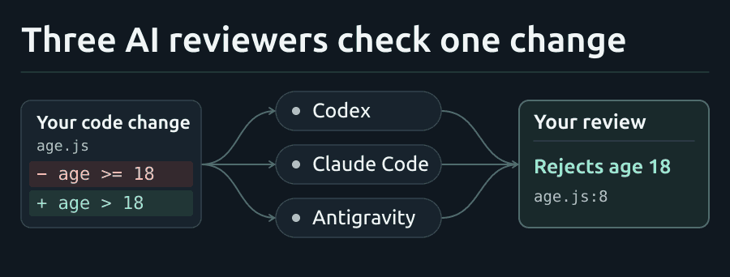

# agy-handoff



Use Antigravity, Claude Code, or Codex to delegate a focused task, review changes independently, or compare implementation plans. All three integrations use the same local MCP server, CLI runners, settings, and job format. The active session verifies the results and writes the final synthesis.

## Install

Use Node.js 18.18 or later. Install and sign in to the external CLIs you want to use. The runner minimums are Codex 0.160.0, Claude Code 2.1.259, and Antigravity 1.5.0. Keep your main harness on a current release with plugin support.

```sh
git clone https://github.com/CourageHW/agy-handoff.git
```

### Antigravity · agy-handoff

```sh
agy plugin install ./agy-handoff
```

Open Antigravity in the target repository and run these commands.

```text
/agy-handoff:handoff-doctor
/agy-handoff:handoff-cross-review Review my uncommitted changes.
```

The installed Antigravity plugin keeps its original three-engine cross-review and planning defaults. Its three subagents remain available in Antigravity CLI. Use `/agents` to inspect an individual subagent run. To review with only Codex and Claude Code, say “Ask the other two agents to review my changes.” For removal, run `agy plugin uninstall agy-handoff`. [Antigravity plugin docs](https://antigravity.google/docs/cli/plugins/)

### Claude Code · claude-handoff

```sh
cd agy-handoff
npm run package:integrations
claude plugin marketplace add ./dist/handoff-plugins
claude plugin install handoff-bridge@agy-handoff
```

Start Claude Code in the target repository. Use `/mcp` to check the connection. The native plugin ID is `handoff-bridge` because Claude Code reserves the `claude-` prefix.

```text
/handoff-bridge:handoff-doctor
/handoff-bridge:handoff-cross-review Ask the other two agents to review my changes.
/handoff-bridge:handoff-delegate Delegate debugging this failing test to Codex.
```

Claude Code defaults to Codex and Antigravity for cross-review and planning. You can also load the bundle for a single session with `claude --plugin-dir /absolute/path/to/dist/handoff-plugins/plugins/claude-handoff`. For removal, run `claude plugin uninstall handoff-bridge@agy-handoff` and optionally `claude plugin marketplace remove agy-handoff`. [Claude Code plugin manifest](https://code.claude.com/docs/en/plugins-reference) · [Claude Code skills](https://code.claude.com/docs/en/skills)

### Codex · codex-handoff

```sh
cd agy-handoff
npm run package:integrations
codex plugin marketplace add ./dist/handoff-plugins
codex plugin add codex-handoff@agy-handoff
```

Start Codex in the target repository. Select the bundled skill using `$` or ask in natural language. Approve the requested handoff in Codex if prompted. Use a local session with interactive approvals when a tool requires approval.

```text
$handoff-doctor
$handoff-cross-review Ask the other two agents to review my changes.
$handoff-plan Compare implementation proposals for this feature.
```

Codex defaults to Claude Code and Antigravity for cross-review and planning. Use `/mcp` to check the connection. For removal, run `codex plugin remove codex-handoff@agy-handoff` and optionally `codex plugin marketplace remove agy-handoff`. [Codex plugin packaging and MCP policy](https://developers.openai.com/plugins/build/plugins) · [Codex skills](https://developers.openai.com/codex/skills)

After pulling updates, rebuild the local marketplace and reinstall its plugins to refresh the cached packages.

## Review, plan, and delegate

| Skill | Example request |
| --- | --- |
| `handoff-review` | Get an independent second opinion from Antigravity on this diff. |
| `handoff-cross-review` | Ask the other two agents to review my changes or compare the proposed implementations. |
| `handoff-grill-me` | Work through open design questions before writing a plan. |
| `handoff-plan` | Create a collaborative implementation plan with file targets and tests. |
| `handoff-delegate` | Ask Codex to trace this failing test. Include the failing command and relevant files. |
| `handoff-models` | Show or change default models and reasoning effort by engine and command. |

A single review or delegation accepts an explicit `engine` or uses `engine: "auto"`. Cross-review and planning accept an explicit `engines` list, including the main harness's CLI if requested. Existing clients can still use `includeAgy` to choose the legacy three-engine or Codex-and-Claude roster. Pass the target repository as `cwd` and scope the request with `context.files` and `context.summary`.

Structured results list requested and participating engines, per-engine errors, and the active session as synthesizer. A missing CLI, quota error, timeout, or invalid payload can leave a partial result. The server checks cited files and line numbers and verifies proposed plan targets on disk. Confirm defects by reading the code and checking its behavior before acting on reviewer agreement.

For long single-engine reviews and delegations, use `background: true` and collect the job ID. Claude Code and Codex use `handoff_job_status` and `handoff_job_result` for progress and execution evidence. Use `handoff_job_status` with `includeStats: true` and no job ID to see recorded usage. Cross-review and planning stream progress in a single MCP call.

## Terminal usage

From the plugin checkout, pass the target repository with `--cwd`. For example, to review a feature branch against its local `main` branch, run the following command.

```sh
node src/cli.mjs cross-review --cwd ../my-project --scope base --base main --structured
```

For a focused review, pass the file path and the question you want answered.

```sh
node src/cli.mjs review --cwd ../my-project --engine codex --scope custom \
  --files src/jobs.mjs --prompt "Check how failed jobs are retried."
```

Use `node src/cli.mjs watch` to follow active jobs and `node src/cli.mjs stats --table` to see outcomes, duration, and CLI-reported usage. Run `node src/cli.mjs --help` for other commands. Use `--engines codex,claude` to choose a roster for `cross-review` or `plan`.

## Permissions and retries

Reviews and plans run in read-only mode. Delegation defaults to read-only. In Claude Code and Codex, set `mode: "workspace-write"`, `confirmWorkspaceWrite: true`, and the target `cwd` only after the user authorizes edits by the external engine. Host approval prompts still apply.

| Engine | Read-only | Workspace write |
| --- | --- | --- |
| Codex | Codex read-only sandbox | Codex workspace-write sandbox |
| Claude Code | Restricted file tools and an allowlist of read-only Git commands | File tools are confined to the working directory. **Bash runs without an OS sandbox.** |
| Antigravity | `--sandbox --mode plan` | `--sandbox --mode accept-edits` |

Child sessions cannot initiate another handoff through the MCP tools or Handoff CLI. An identical in-flight request in the same MCP server is rejected. Use the existing job status before submitting another request.

After a failed read-only job, check its status for `retryable` before calling `handoff_job_retry`. If a write fails partway through, inspect the working tree before starting another job. On foreground read-only runs, Antigravity can switch from Neon to Argon once if Neon reports a quota error.

## Configuration

Run `node src/cli.mjs models show` to see the active defaults. Auto-routing selects among the active harness's external engines using CLI availability, compatibility, recent failures, and routing preferences. The settings file supports `balanced`, `least-used`, `prefer-codex`, `prefer-claude`, and `prefer-agy`. Automatic workspace-write routing excludes Claude Code unless `routing.allowUnsandboxedWriteAuto` is enabled.

The plugins pass their host explicitly. For a standalone server, use `node src/mcp-server.mjs --host claude` (or `codex` / `antigravity`). Standalone `--host antigravity` uses the two external engines by default. A bare server invocation keeps the legacy three-engine group roster and Codex/Claude auto-routing.

| Environment variable | Purpose |
| --- | --- |
| `AGY_HANDOFF_CODEX_BIN`, `AGY_HANDOFF_CLAUDE_BIN`, `AGY_HANDOFF_AGY_BIN` | Set an executable path for one engine. Set `AGY_HANDOFF_AGY_BIN=none` to disable the Antigravity reviewer. |
| `AGY_HANDOFF_HOST` | Select defaults for standalone CLI/MCP sessions. An explicit MCP launch argument takes precedence. |
| `AGY_HANDOFF_CONFIG` | Use a different model and routing configuration file. |
| `AGY_HANDOFF_JOBS_DIR` | Choose where to store job logs and event streams. Set the same directory in the MCP and terminal environments to inspect the same jobs from both. |

<details>
<summary>MCP tool reference</summary>

| Task | Tools |
| --- | --- |
| Check the installation or change settings | `handoff_doctor`, `handoff_config` |
| Review, plan, or delegate | `handoff_review`, `handoff_cross_review`, `handoff_plan`, `handoff_delegate` |
| Follow a job or retrieve its output | `handoff_job_status`, `handoff_job_result` |
| Cancel a background job or retry an eligible job | `handoff_job_cancel`, `handoff_job_retry` |

</details>

## Development

Run `npm test` for unit and MCP tests with mock CLIs. The CI matrix runs those tests on Linux, macOS, and Windows. Run `agy plugin validate --strict .` to check the existing Antigravity bundle. After packaging, run `claude plugin validate ./dist/handoff-plugins/plugins/claude-handoff` to check the Claude Code bundle.

For live checks, use the Quick Start in each host and verify the actual MCP tool call and responding engines. Run `npm run test:live` for the existing runner smoke suite with installed, authenticated CLIs. A mock pass verifies the local protocol and runner wiring. Live runs also depend on host permissions, CLI versions, authentication, and provider quotas.

[Contributing](./CONTRIBUTING.md) · [Changelog](./CHANGELOG.md) · [MIT license](./LICENSE)
