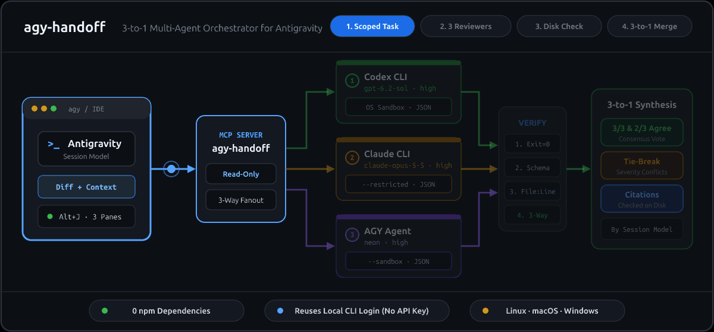

# agy-handoff

**agy-handoff** turns Google Antigravity (`agy` CLI, Antigravity IDE, and Antigravity 2.0) into a multi-engine orchestrator backed by local **OpenAI Codex** and **Anthropic Claude Code** CLIs over a zero-dependency stdio MCP server.

It reuses whatever `codex` and `claude` sessions you are already signed into locally—no `npm install` step and no separate API keys—while addressing common multi-agent workflow failures: redundant repo scans, unverified tool claims, quota bottlenecks, context bleed across subagents, and silent CLI crashes.

<p align="center">
  
</p>

## What agy-handoff Solves

- **Zero npm dependencies**: Pure Node.js (`>= 18.18.0`) standard library modules.
- **Context-aware handoff**: Pass scoped `context: { files, summary, constraints, acceptanceCriteria }` (or `--files` / `--context-summary`) so external CLIs start directly on target code instead of wasting tokens re-scanning the repo.
- **Factual execution evidence**: Every foreground and background run records observed tool calls, commands, inspected/modified files, and `git status` delta (`workspaceGitDelta`), flagging runs where no tools or edits occurred.
- **Structured verified cross-review**: Run Codex and Claude Code in parallel via `handoff_cross_review` (even if one CLI is missing). Pass `structured: true` to enforce JSON schemas (`--output-schema` / `--json-schema`), compute Consensus / Severity Conflicts / Unique findings using both location and defect-token/concept overlap (`matchBasis` prevents merging unrelated bugs on nearby lines), and separate 4 verification stages (`cliExecution`, `structuredJsonParse`, `citationValidity`, and `semanticVerification: { semanticallyVerified: false }`).
- **Safe read-only recovery & opt-in routing**: `handoff_doctor` recovers orphaned `running` jobs from crashed servers, `handoff_job_retry` replays failed `read-only` jobs (same engine or fallback engine, never `workspace-write`), and optional `engine: "auto"` balances usage across recent jobs and unhealthy streaks.
- **Inspectable live progress & stats**: Dedicated `codex-handoff` / `claude-handoff` subagents for Antigravity's `/agents` (`Alt+J`) panes, plus `node src/cli.mjs watch` and `node src/cli.mjs stats --table`.

---

## Quick Start

### 1. Install

```bash
agy plugin install https://github.com/CourageHW/agy-handoff
```

Or from a local clone:

```bash
git clone https://github.com/CourageHW/agy-handoff.git
agy plugin validate --strict ./agy-handoff
agy plugin install ./agy-handoff
```

### 2. Verify local CLIs (`doctor`)

In Antigravity:

```text
/agy-handoff:handoff-doctor
```

Or in your terminal:

```bash
node src/cli.mjs doctor
```

### 3. Run a scoped read-only review

```bash
node src/cli.mjs review --engine codex --style standard --scope uncommitted --files src/jobs.mjs,src/mcp-server.mjs
```

### 4. Run a structured dual-engine cross-review

```bash
node src/cli.mjs cross-review --style adversarial --scope base --base main --structured
```

### 5. View usage & performance stats

```bash
node src/cli.mjs stats --table
```

---

## Slash Commands & Subagents

The plugin bundles five slash commands/skills (`handoff-doctor`, `handoff-review`, `handoff-cross-review`, `handoff-delegate`, `handoff-models`) and two context-isolated subagents (`codex-handoff`, `claude-handoff`):

- `/agy-handoff:handoff-doctor`: Checks Node.js, binary paths/versions, required CLI flags, auth hints, model/routing defaults, and recovers stale orphaned jobs.
- `/agy-handoff:handoff-review`: Runs a read-only `standard` or `adversarial` review (`engine: "codex" | "claude" | "auto"`) with optional `context` and `structured` JSON output.
- `/agy-handoff:handoff-cross-review`: Runs Codex and Claude Code in parallel and synthesizes **Consensus Findings**, **Unique Findings**, **Conflicts / Trade-offs**, and **Verified Findings** (confirmed directly against local files).
- `/agy-handoff:handoff-delegate`: Delegates focused investigations, debugging, or scoped edits (`read-only` by default; `workspace-write` requires explicit user confirmation). Supports session resume (`sessionId`) and execution evidence tracking.
- `/agy-handoff:handoff-models`: Views or updates default models, reasoning efforts, and `routing` policy (`balanced`, `prefer-codex`, `prefer-claude`, `least-used`, or per `taskType`).

### Live Monitoring (`Alt+J` / `watch` / `stats`)

In Antigravity CLI, running reviews or delegations through `codex-handoff` and `claude-handoff` isolates raw CLI stream noise from the parent context and creates inspectable panes under `/agents` (`Alt+J`) backed by `handoff_job_status` (`waitSec` / `sinceSeq`). *(Note: Antigravity's subagent header renders the wrapper model `flash` beside the agent name; the external model and effort appear in the role label and launch note.)*

From another terminal tab or tmux pane:

```bash
node src/cli.mjs watch           # Live dashboard across active and recent jobs
node src/cli.mjs watch <jobId>   # Follow a single job until completion
node src/cli.mjs watch --once    # Single snapshot
node src/cli.mjs stats --table   # ASCII usage, engine share, success rate, reported tokens/cost
```

*(Note: `stats` and `handoff_job_status({ includeStats: true })` aggregate only exact values recorded by local CLIs—missing tokens or costs are never estimated.)*

---

## Default Models & Routing Policy

Built-in defaults when no override is supplied:

- **Codex**: `gpt-6.2-sol` (`high`)
- **Claude Code**: `claude-opus-5-5` (`high`)
- **Auto-routing (`engine: "auto"`)**: `balanced` (least-used across last 20 jobs + automatic avoidance when one CLI failed 2+ consecutive recent runs). Explicit `engine: "codex"` or `"claude"` always takes precedence.

Change defaults via `/agy-handoff:handoff-models`, `handoff_config`, or the CLI:

```bash
node src/cli.mjs models show
node src/cli.mjs models set review codex gpt-6.2-sol xhigh
node src/cli.mjs models set cross-review --codex-model gpt-6.2-sol --codex-effort high --claude-model opus5.5 --claude-effort high
node src/cli.mjs models set delegate claude cli-default
node src/cli.mjs models reset all
```

---

## Sandbox & Permission Model

| Mode | OpenAI Codex (`codex`) | Anthropic Claude Code (`claude`) |
| :--- | :--- | :--- |
| **`read-only`** *(default)* | Explicit `-s read-only` (or `sandbox_mode="read-only"`). OS-enforced read-only sandbox. | `--permission-mode dontAsk --restricted --strict-mcp-config --permission-prompts none --tools Read,Grep,Glob,Bash` + allowlist for read-only `git` commands and `--disallowedTools` blocking `Edit`, `Write`, `NotebookEdit`, and file-writing `git` flags (`--output*`, `--ext-diff*`, `--textconv*`). |
| **`workspace-write`** *(explicit opt-in)* | Explicit `-s workspace-write` (OS sandbox confined to `cwd`, network restricted). Rejects `sessionId="last"` and protected system/root/home directories. | `--permission-mode acceptEdits --restricted --strict-mcp-config --tools Read,Edit,Write,Grep,Glob,Bash` + expanded `--disallowedTools` blocking privilege escalation (`sudo`, `su`, `doas`, `pkexec`), destructive/remote git (`git push*`, `git reset --hard*`, `git clean -f*`), directory escape (`rm -rf /*`, `rm -rf ~*`, `rm -rf ..*`, `cd /*`, `cd ~*`, `cd ..*`), and remote exfiltration/publishing. Confines built-in file tools to `cwd`, **but `Bash` itself runs without an OS filesystem/network sandbox**. |

**Shared guarantees:**
- Neither engine is ever invoked with `--dangerously-bypass-approvals-and-sandbox` or `--dangerously-skip-permissions`.
- `validateWorkspaceWriteCwd` refuses `workspace-write` in filesystem roots (`/`), OS system directories (`/etc`, `/usr`, `/bin`, `C:\Windows`, etc.), the raw user home directory (`~`), and sensitive credential/config directories (`~/.ssh`, `~/.gnupg`, `~/.aws`, `~/.claude`, `~/.codex`, `~/.gemini`).
- `engine: "auto"` excludes Claude Code in `workspace-write` mode unless `routing.allowUnsandboxedWriteAuto: true` is explicitly configured, and `handoff_delegate` attaches an explicit `permissionBoundary` and `executionEvidence` warnings whenever outside-workspace shell paths are observed.
- Only `read-only` jobs store a bounded replay spec and can be replayed via `handoff_job_retry`; `workspace-write` retries are refused.
- Prompts travel over `stdin`; binaries resolve to absolute paths and spawn with `shell: false`; job logs live in `0700`/`0600` directories; timeouts and cancellations terminate child process trees cleanly.

---

## OS & CLI Compatibility

| Platform | Runtime / Minimum CLI Versions | Tested Baseline | CI Coverage |
| :--- | :--- | :--- | :--- |
| **Linux** (Ubuntu) | Node.js `>= 18.18.0`, Codex `>= 0.160.0`, Claude Code `>= 2.1.259` | Node `22.22.1`, Codex `0.171.0`, Claude `2.1.325` | Node `18`, `20`, `22` |
| **macOS** | Node.js `>= 18.18.0`, Codex `>= 0.160.0`, Claude Code `>= 2.1.259` | CI verified (`macos-latest`) | Node `18`, `20`, `22` |
| **Windows** | Node.js `>= 18.18.0`, Codex `>= 0.160.0`, Claude Code `>= 2.1.259` | CI verified (`windows-latest`) | Node `18`, `20`, `22` |

> **Why Claude Code `>= 2.1.259`?** `agy-handoff` requires `--restricted` (introduced in `2.1.248`) and `--permission-prompts none` (introduced in `2.1.259`) so unattended read-only runs cannot hang on permission prompts or load untrusted repo settings.

---

## How It Compares

| Tool | Direction | Scope | How It Differs |
| :--- | :--- | :--- | :--- |
| **`agy-handoff`** | **Antigravity → Codex & Claude Code** | Dual-engine MCP server, subagents, skills, structured verification, `watch` & `stats` | Built around Antigravity as host with `--restricted` safety, execution evidence checks, safe read-only recovery, and zero npm dependencies. |
| **`codex-plugin-cc`** | Claude Code → Codex | Official OpenAI plugin inside Claude Code | Targets Claude Code users calling Codex; single-engine. |
| **`cc-suite`** | Cross-CLI Workspace Sync | Unifies `AGENTS.md` and `.agents/skills/` across Claude, Codex, and `agy` | Complementary rule/skill sync rather than dual-engine MCP execution or evidence-checked cross-reviews. |

---

## MCP Tools (9)

| Tool | Description |
| :--- | :--- |
| `handoff_doctor` | Inspect Node, CLI paths/versions, flag compatibility, auth hints, routing defaults, and recover stale jobs |
| `handoff_review` | Read-only `standard`/`adversarial` review (`codex`, `claude`, or `auto`), optional `context` and `structured` output |
| `handoff_delegate` | Scoped task handoff (`read-only` default, `workspace-write` opt-in; supports `context`, `engine: "auto"`, `sessionId`) |
| `handoff_cross_review` | Parallel Codex + Claude Code review with timing summary and optional `structured` Consensus/Conflict/Citation synthesis |
| `handoff_config` | Get, set, or reset model defaults, effort levels, and routing policies |
| `handoff_job_status` | List jobs, long-poll live events (`waitSec`, `sinceSeq`), or fetch aggregated stats (`includeStats`) |
| `handoff_job_result` | Fetch final output, `executionEvidence`, `sessionId`, `costUsd`, and `usage` for a job |
| `handoff_job_cancel` | Cancel a running background job owned by the active server |
| `handoff_job_retry` | Safely replay a finished `read-only` job on the same or alternate engine (`fallbackEngine: true`) |

## Environment Variables

| Variable | Description |
| :--- | :--- |
| `AGY_HANDOFF_CODEX_BIN` | Override path to `codex` executable if outside `PATH` |
| `AGY_HANDOFF_CLAUDE_BIN` | Override path to `claude` executable if outside `PATH` |
| `AGY_HANDOFF_CONFIG` | Custom path for the model & routing config JSON file |
| `AGY_HANDOFF_JOBS_DIR` | Custom directory for job logs and event streams (`watch` auto-detects Antigravity's `plugin_data/agy-handoff/jobs`) |

---

## Development & Testing

```bash
npm test                        # Unit + mock MCP E2E suite (runs in CI, no auth needed)
agy plugin validate --strict .  # Validate Antigravity plugin manifest, skills, agents, rules
node src/cli.mjs doctor         # Check local Codex/Claude binary & flag compatibility
node src/cli.mjs stats --table  # Visual usage summary over retained jobs
npm run test:live               # Live local E2E suite against real signed-in Codex/Claude CLIs
```

A VHS tape recipe for generating a terminal demo GIF lives in [`assets/demo.tape`](./assets/demo.tape).

---

## Known Limitations & Boundaries

- **Antigravity host limits**: Antigravity's native UI quota metering, built-in conversation compaction thresholds, and upstream IDE extension packaging are controlled by Antigravity itself rather than third-party MCP plugins. `agy-handoff` mitigates their impact by tracking external CLI job stats (`stats`), persisting `sessionId` across turns, and isolating raw CLI chatter inside `codex-handoff` / `claude-handoff` subagents.
- **`unknown option: --restricted` / `--permission-prompts`**: Upgrade Claude Code to `>= 2.1.259` (`claude update`) and verify via `node src/cli.mjs doctor`.
- **Claude `workspace-write` Bash boundary**: Keep `read-only` unless edits are explicitly requested.

## License

[MIT](./LICENSE) · [Changelog](./CHANGELOG.md) · [Korean docs (한국어)](./README.ko.md)
